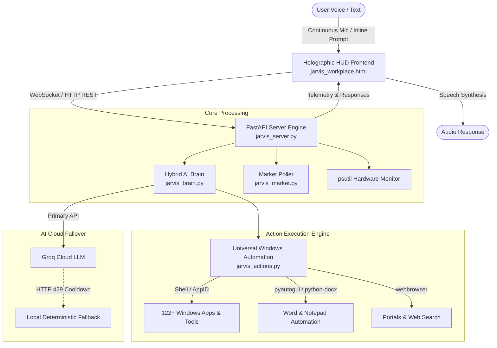

# ⚡ J.A.R.V.I.S · MARK VII Executive Assistant

<div align="center">


**A high-performance, hands-free voice and text-controlled AI executive assistant for Windows.**  
Inspired by Tony Stark's J.A.R.V.I.S., engineered with dynamic desktop automation, real-time financial telemetry, system diagnostics, and a responsive Pitch Black & Neon Green holographic HUD.

</div>

---

## 🌟 Key Features

### 🎙️ Hands-Free Voice & In-Browser Speech
- **Continuous Voice Monitoring:** Powered by Web Speech Recognition with real-time speech debouncing.
- **In-Browser Natural TTS:** High-fidelity speech output with local Windows Speech (`System.Speech` / `pyttsx3`) fallbacks.
- **Dynamic Arc Reactor HUD:** 60 FPS HTML5 Canvas engine featuring audio-reactive frequency spikes, orbital telemetry nodes, and an animated wireframe globe core.

### 🖥️ Universal Windows Automation & App Discovery
- **122+ Windows Applications Pre-Indexed:** Instant discovery and launching for all Modern UWP, Windows 32, and Desktop applications.
- **Exhaustive Natural Aliases:** Recognizes nicknames, abbreviations, and conversational phrasings (e.g. *"open word"*, *"launch mongo"*, *"can you open antigravity"*, *"camera"*, *"calc"*).
- **Windows System Tools & Settings:** Direct control over Task Manager, Control Panel, Device Manager, Disk Cleanup, Bluetooth, Wi-Fi, Sound, Display, and Battery settings.
- **Folder & Drive Navigation:** One-shot opening for Downloads, Desktop, Documents, Pictures, Videos, and drives.

### 🧠 Hybrid Cloud Brain with Zero-Crash Failover
- **Ultra-Fast LLM Reasoning:** Integrates with free Groq Cloud endpoints (`gpt-oss-20b`, `qwen3.8-27b`, etc.) for sub-second conversational intelligence.
- **Automatic Rate-Limit Backoff (HTTP 429):** Detects cooldowns automatically and gracefully routes queries to local deterministic action engines without interruption.
- **Context Retention:** Maintains conversational memory for natural multi-turn interactions.

### 📈 Live Financial Telemetry & Technical Signals
- **Real-Time Market Tracking:** Automated background polling for Nifty 50, Sensex, Reliance Industries, TCS, Infosys, HDFC Bank, Nvidia, Apple, and Bitcoin.
- **Technical Indicators & Sparklines:** Computes momentum, moving average comparisons, and generates SVG sparklines with `STRONG BUY`, `BUY / ACCUMULATE`, `HOLD`, and `SELL` recommendations.

### 💻 Real-Time Hardware Diagnostics
- **Live Vitals Monitoring:** Displays real-time CPU utilization, RAM usage, free disk storage, battery percentage, charging state, and system uptime directly in the HUD.

### ✍️ Document Generation & Typing Automation
- **AI Word Document Writer:** Generates structured research papers, reports, or letters and saves them straight into Microsoft Word (`.docx`).
- **Hands-Free Typing:** Automates typing notes into Notepad or active desktop windows via simulated keyboard control.

### 🔄 Session Management & Chat Controls
- **One-Click Session Reset:** Includes a dedicated `CLEAR & NEW` control that purges conversation history, resets AI memory context, and arms a fresh session instantly.

---

## 🏗️ Architecture



---

## 📂 Repository Structure

```
JARVIS_MARK_VII/
├── jarvis_server.py         # Main FastAPI backend server and state engine
├── jarvis_actions.py        # Universal Windows desktop automation & app indexer
├── jarvis_brain.py          # Groq Cloud AI brain with rate-limit failover
├── jarvis_market.py         # Live stock market poller & technical analysis
├── jarvis_voice.py          # Standalone terminal voice loop
├── jarvis_workplace.html    # Pitch Black & Neon Green holographic HUD
├── start_hud.bat            # One-click cache-clearing launcher for Windows
├── start_voice.bat          # Standalone terminal voice launcher
├── install.bat              # Automated Windows setup script
├── install.sh               # macOS / Linux setup script
├── requirements.txt         # Complete Python dependencies
├── .env.example             # Template for API credentials
├── .gitignore               # Excludes secrets, caches, and virtual environments
└── README.md                # Project documentation
```

---

## 🚀 Quick Start Guide

### Prerequisites
- **Operating System:** Windows 10 or Windows 11 (64-bit recommended)
- **Python:** Version 3.10 to 3.15 ([python.org](https://www.python.org/downloads/))
- **Browser:** Google Chrome, Microsoft Edge, or Brave (for Web Speech API support)

---

### Step 1: Clone Repository

```bash
git clone https://github.com/yarnagulagauravdeep-cyber/JARVIS_MARK_VII.git
cd JARVIS_MARK_VII
```

---

### Step 2: Set Up Virtual Environment & Dependencies

```cmd
# Create virtual environment
python -m venv .venv

# Activate virtual environment
call .venv\Scripts\activate

# Install dependencies
pip install -r requirements.txt
```

---

### Step 3: Configure Groq API Key

1. Get a free high-speed API key from [Groq Console](https://console.groq.com/keys).
2. Copy `.env.example` to `.env`:
   ```cmd
   copy .env.example .env
   ```
3. Open `.env` and paste your key:
   ```env
   GROQ_API_KEY=gsk_your_actual_api_key_here
   ```

*(Note: If no API key is provided, Jarvis will still operate seamlessly in local offline mode, handling all desktop automation, market queries, and system tasks!)*

---

### Step 4: Launch J.A.R.V.I.S

Simply double-click:
```
start_hud.bat
```
Or run from terminal:
```cmd
python jarvis_server.py
```

The server will initialize on `http://localhost:8000`.

1. Open **`http://localhost:8000`** in Chrome or Edge.
2. Click anywhere on the initialization screen to engage the microphone.
3. Start speaking naturally!

---

## 🗣️ Command Reference Guide

| Category | Example Phrases | Action Taken |
| :--- | :--- | :--- |
| **Desktop Applications** | *"Open Word"*, *"Launch Excel"*, *"Can you open MongoDB"*, *"Open Antigravity"*, *"Omnirush"*, *"Calculator"*, *"Camera"* | Resolves and opens the exact application via Windows Shell or AppID |
| **System Tools** | *"Open Task Manager"*, *"Open Settings"*, *"Open Bluetooth"*, *"Open Disk Cleanup"*, *"Device Manager"* | Opens the requested Windows management utility or settings page |
| **Directories** | *"Open Downloads"*, *"Open my Desktop"*, *"Open Documents"*, *"Open C Drive"* | Opens the corresponding folder in Windows File Explorer |
| **Typing Automation** | *"Open Notepad and write Project Status Update"*, *"Type Hello Team"* | Launches Notepad and automatically types out the specified text |
| **Document Writing** | *"Write a document about Quantum Computing in Word"* | Generates a structured multi-section document and loads it in Microsoft Word |
| **Financial Markets** | *"Stock report"*, *"How is Reliance doing?"*, *"Sensex price"*, *"Should I buy Nvidia?"* | Returns live price, daily change, and algorithmic technical indicator |
| **Media & Audio** | *"Play lofi hip hop on YouTube"*, *"Volume up"*, *"Volume down"*, *"Mute"* | Searches YouTube or adjusts system master volume levels |
| **Session Control** | Click `CLEAR & NEW` in the HUD | Clears chat stream and wipes AI conversation memory |

---

## 🔒 Security & Privacy

- **No Secret Leaks:** `.env` and personal keys are strictly ignored by `.gitignore`.
- **Local Desktop Control:** All automation scripts run directly on your workstation without third-party telemetry.
- **Zero Cache Server:** Built-in anti-caching HTTP headers ensure your browser always loads the freshest interface and state.

---

## 📄 License

This project is licensed under the [MIT License](LICENSE).  
Developed for high-efficiency Windows personal and executive productivity.
